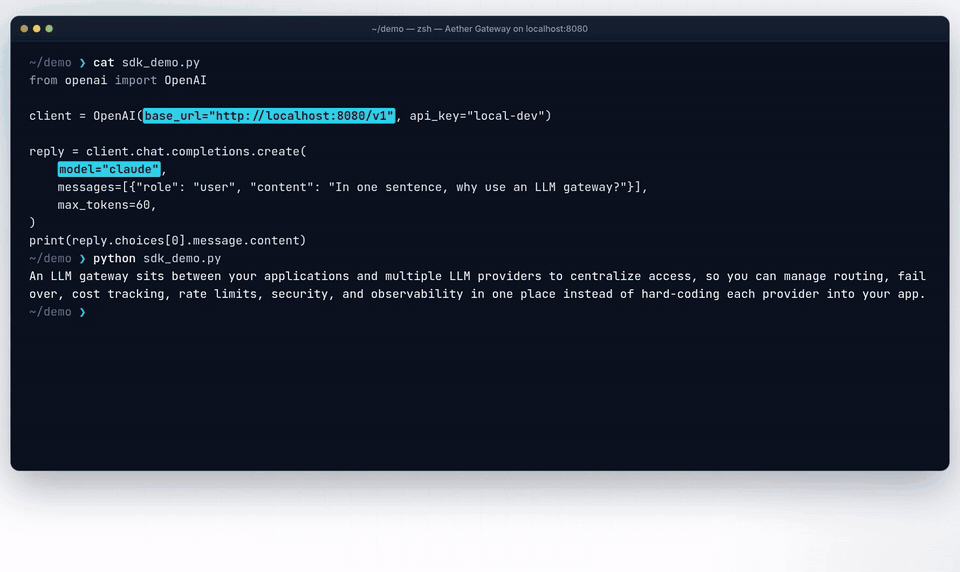
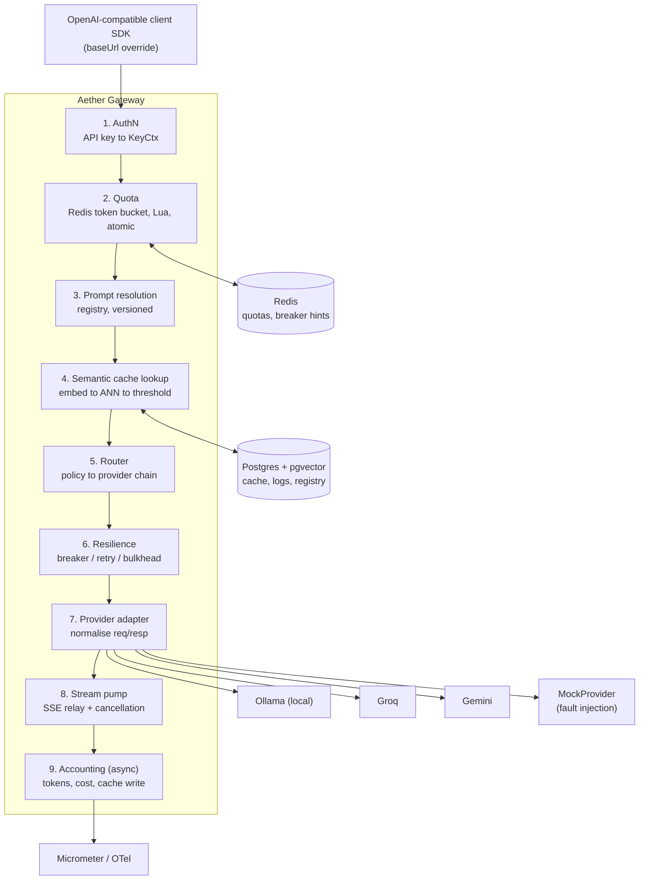

<p align="center">
  
</p>

# Aether Gateway

[](https://github.com/Ashish-CodeJourney/aether-gateway/actions/workflows/ci.yml)
[](https://github.com/Ashish-CodeJourney/aether-gateway/actions/workflows/docs.yml)
[](https://github.com/Ashish-CodeJourney/aether-gateway/releases/latest)
[](https://ashish-codejourney.github.io/aether-gateway/)
[](https://hub.docker.com/r/ashishvaghelaa/aether-gateway-proxy)
[](LICENSE)

**One self-hosted, OpenAI-compatible endpoint in front of all your LLM providers, with failover, caching, quotas and per-request cost tracking built in.**

Free and open source (MIT). Java 25 / Spring Boot 4.1.

<p align="center">
  <a href="https://ashish-codejourney.github.io/aether-gateway/#watch">
    
  </a>
  <br>
  <a href="https://ashish-codejourney.github.io/aether-gateway/#watch"><b>▶ Watch the 70-second demo</b></a>
</p>

**[Documentation](https://ashish-codejourney.github.io/aether-gateway/)**: setup guide, usage guide, architecture decision records and design docs.

## Who it's for

- Teams that want **one OpenAI-compatible endpoint** across Ollama, Groq, Gemini, Anthropic, OpenAI and any other OpenAI-compatible provider, without changing application code when a provider changes or goes down.
- Teams that need to **self-host** the gateway, keeping prompts, keys and the request log on their own infrastructure.
- **JVM and Spring shops** in particular, who want a gateway they can read, debug, extend and run with tooling they already know.

## Quickstart

```bash
docker compose up -d
# First run builds the images and downloads the embedding model; give it a minute, then:
curl -X POST http://localhost:8080/v1/chat/completions \
  -H "Content-Type: application/json" \
  -d '{"model":"mock","messages":[{"role":"user","content":"hello"}]}'
```

That brings up the gateway, Postgres + pgvector, Redis, two mock providers (so you can test failover without a real outage), Prometheus, and Grafana with a pre-built dashboard at `http://localhost:3000`. You don't need any provider keys to try it.

Then point any OpenAI SDK at `http://localhost:8080/v1`.

**Python**

```python
from openai import OpenAI

client = OpenAI(base_url="http://localhost:8080/v1", api_key="local-dev")
reply = client.chat.completions.create(
    model="mock",
    messages=[{"role": "user", "content": "What is 2+2?"}],
)
print(reply.choices[0].message.content)
```

**TypeScript**

```ts
import OpenAI from "openai";

const client = new OpenAI({ baseURL: "http://localhost:8080/v1", apiKey: "local-dev" });
const reply = await client.chat.completions.create({
  model: "mock",
  messages: [{ role: "user", content: "What is 2+2?" }],
});
console.log(reply.choices[0].message.content);
```

The Compose stack allows anonymous requests so the quickstart works without creating a key first. Outside local development, create real API keys through the admin API. Anonymous access is off by default and in the Kubernetes manifests. To use real providers, set their keys (for example `OPENAI_API_KEY` or `GEMINI_API_KEY`) in your shell or a root `.env` file and use the `gpt` or `gemini` model aliases from [`routing.docker.yaml`](routing.docker.yaml).

### What you get back

Every response includes headers that show what the gateway did. This output was captured from the Compose stack:

```console
$ curl -sS -D - http://localhost:8080/v1/chat/completions -H "Content-Type: application/json" \
    -d '{"model":"mock","messages":[{"role":"user","content":"What is 2+2?"}]}'
HTTP/1.1 200 OK
X-Aether-Cache: MISS
X-Aether-Cost-USD: 0.0000195
X-Aether-Attempts: 1
X-Aether-Provider: mock-primary

# Same prompt again: served from the exact-match cache, no provider call, no cost
X-Aether-Cache: EXACT_HIT
X-Aether-Cost-USD: 0

# Make the primary provider fail, then send a new prompt.
# The gateway fails over to the fallback. The client changes nothing.
$ curl -sS -X POST http://localhost:8082/_mock/config \
    -H "Content-Type: application/json" -d '{"fail_mode":"503","fail_rate":1.0}'
X-Aether-Cache: MISS
X-Aether-Attempts: 1
X-Aether-Provider: mock-fallback
```

## Features

- **Multi-provider failover.** Each model alias maps to an ordered chain of providers. Circuit breakers, retries and bulkheads (resilience4j) move traffic to the next healthy provider. Failover took 67.92 ms at p99 over 100 independent injected outages.
- **Exact-match response caching.** Repeated identical requests are answered from Redis, with Postgres behind it, and cost nothing. Each API key has its own cache namespace, and caching is skipped for requests with `temperature > 0.3`, requests with tools, and any request that sends `X-Aether-No-Cache`. If the cache fails, requests go straight to the provider (fail-open).
- **Quotas and rate limits per API key.** Monthly token budgets, rate limits and concurrency caps, enforced atomically in Redis. Tokens are reserved before the request and reconciled to the real count afterwards. If quota enforcement fails, requests are rejected rather than let through unmetered (fail-closed).
- **Cost on every response.** `X-Aether-Cost-USD`, `X-Aether-Provider`, `X-Aether-Attempts`, `X-Aether-Failover-Chain` and `X-Aether-Quota-Remaining` headers. Prices come from a hot-reloadable [`cost-model.yaml`](aether-gateway/cost-model.yaml).
- **Streaming with cancellation.** SSE in the same format as OpenAI's. When a client disconnects, the gateway cancels the upstream request, so you stop paying for tokens nobody will read.
- **Observability.** Micrometer/Prometheus metrics and a pre-built Grafana dashboard covering latency by provider, cache hit rate, spend and spend avoided, breaker state, in-flight streams, top keys by cost, and errors. There is also a per-request log you can query.
- **Operator console and admin API.** Manage API keys (stored as salted hashes), a versioned prompt registry, cache stats and the request explorer. See [`console/README.md`](console/README.md).
- **Kubernetes-ready.** Plain manifests in [`k8s/`](k8s/) with a PodDisruptionBudget, a NetworkPolicy and graceful SSE draining. In two real rolling updates, all 1,000 in-flight streams (500 per rollout) finished without a break.
- **Hot-reloadable routing.** Edit `routing.yaml` and `POST /admin/routes/reload` applies it without a restart. Provider credentials are referenced by environment variable *name*, so the config file is safe to commit. Provider base URLs are checked against private network ranges (SSRF protection).
- **Tool calling.** OpenAI-format `tools`, `tool_choice`, assistant `tool_calls` and `tool` results pass through end to end, streaming included (`delta.tool_calls`). Passed through unchanged to OpenAI-compatible providers, and translated to and from Anthropic's Messages API, Gemini's function calling (with JSON Schema converted to Gemini's subset) and Ollama's native `/api/chat`. Ollama can't force a tool call, so `tool_choice: "required"` or a named function gets a clear `400 tool_choice_not_supported` instead of being silently ignored. Tool-calling traffic is never cached.
- **Embeddings.** OpenAI-compatible `POST /v1/embeddings` with the same auth, quotas, failover and cost headers as chat. Supported on OpenAI-compatible providers, Ollama and Gemini. Providers without embeddings support are skipped in the chain.
- **Provider adapters.** Ollama, Groq, Gemini, Anthropic, OpenAI, and a generic adapter for anything that speaks the OpenAI format (LiteLLM, vLLM, TGI, and so on).

### Semantic cache (experimental)

The gateway can also return a cached answer for a prompt that is *similar* to an earlier one. It embeds the prompt (all-MiniLM-L6-v2, running in-process), searches pgvector for near neighbours, and then applies a guard that rejects a match when the numbers, units, dates, named entities, negation or a small set of common opposites ("open"/"closed", "increased"/"decreased") differ.

It is not yet accurate enough to recommend for answers that need to be correct. On a 502-prompt hand-labelled corpus at the default 0.94 threshold with the guard on:

| | Measured |
|---|---|
| Hit rate | 14.47% (11 of 76 paraphrase pairs) |
| False-hit rate (a wrong cached answer served) | **0.0%** (0 of 50 adversarial pairs), in-sample |

Treat that 0% with suspicion. The guard's negation, spelled-out-number, unit and opposites checks were written after reading which of these 50 pairs got through, so it fits this corpus by construction. On 20 new adversarial pairs written after the guard was frozen, it rejected only 6. Opposites outside its short word list ("faster" vs "slower", "fixed" vs "variable" rate) and meaning-bearing common nouns ("finance team" vs "legal team") still pass. [Semantic cache correctness](https://ashish-codejourney.github.io/aether-gateway/docs/design/cache-correctness) covers the full analysis.

**Semantic matching is opt-in per route.** Exact-only caching is `semantic: false` in a route's `cache:` block in `routing.yaml`; the shipped example configs use it, so out of the box only identical requests are served from cache. (A `cache:` block that omits `semantic` keeps the older behaviour, exact plus semantic, so existing configs are unchanged.) Clients can raise the similarity threshold for a request with `X-Aether-Cache-Threshold`, but never lower it below the route's configured value. See [Routing policy](https://ashish-codejourney.github.io/aether-gateway/docs/design/routing-policy).

## How it compares

LiteLLM and Portkey are mature, widely used gateways with much broader provider coverage. If you want the widest set of integrations today, start there. Aether is aimed at teams that want a small, readable JVM codebase with published, reproducible measurements of its own behaviour.

| | Aether Gateway | LiteLLM Proxy | Portkey AI Gateway |
|---|---|---|---|
| Self-hosted | Yes | Yes | Yes (managed service also available) |
| Language / runtime | Java 25, JVM | Python | TypeScript, Node.js |
| License | MIT | MIT for the open-source core; enterprise features licensed separately | MIT |
| Provider coverage | 5 native adapters + any OpenAI-compatible API | Very broad | Very broad |
| Reproducible benchmarks committed in the repo | Yes: [`BENCHMARKS.md`](BENCHMARKS.md), raw CSVs, `make bench` | Not assessed here | Not assessed here |

Competitor details may change. Check their own docs before you decide.

## Benchmarks

Every number below comes from a committed run. The full tables, methodology, caveats and raw CSVs are in **[`BENCHMARKS.md`](BENCHMARKS.md)**, and you can reproduce them with `make bench`.

| Metric | Result | Target |
|---|---|---|
| Gateway overhead on a cache miss, p95 | 6.24 ms | < 15 ms |
| Cache-hit end-to-end latency, p95 | 8.9 ms | < 50 ms |
| Failover latency, p99 (100 independent trials) | 67.92 ms | < 500 ms |
| Quota accuracy, 100 concurrent requests | 0 over-issue | 0 |
| Broken streams during rolling K8s update | 0 of 1,000 | 0 |
| Semantic cache hit rate (0.94 threshold, guard on) | 14.47% | ≥ 35% (not met) |
| Semantic cache false-hit rate | 0.0% on the labelled corpus (in-sample; 6 of 20 new adversarial pairs caught) | ≤ 5% (not shown out of sample) |
| Concurrent streams on 2 vCPU / 4 GB | 37.1% failures at 2,000 | ≥ 2,000 (not met) |

## Architecture



The core follows a hexagonal (ports and adapters) layout. `gateway-core` depends only on the JDK, and ArchUnit tests enforce that. See the [architecture diagram](https://ashish-codejourney.github.io/aether-gateway/docs/design/architecture-diagram) and [module boundaries](https://ashish-codejourney.github.io/aether-gateway/docs/design/module-boundaries).

## Design decisions

| Decision | Why |
|---|---|
| [WebFlux for streaming, virtual threads elsewhere](https://ashish-codejourney.github.io/aether-gateway/docs/adr/webflux-streaming-mvc-virtual-threads-elsewhere) | Passing a client's cancellation through to the provider needs Reactor's operator chain. Nothing else on the request path needs non-blocking I/O. |
| [Local circuit breakers + Redis advisory hint](https://ashish-codejourney.github.io/aether-gateway/docs/adr/circuit-breaker-state-local-with-redis-advisory-hint) | Replicas share a hint about provider health without needing distributed consensus. |
| [Fail-open cache, fail-closed quota](https://ashish-codejourney.github.io/aether-gateway/docs/adr/fail-open-cache-fail-closed-quota) | A cache outage should only lose savings. A quota outage must never let unmetered spend through. |
| [Reserve-then-reconcile token quotas](https://ashish-codejourney.github.io/aether-gateway/docs/adr/reservation-and-reconciliation-for-token-quotas) | Output tokens are unknown until the response finishes, so tokens are reserved up front and corrected afterwards. |
| [Similarity threshold + entity/numeric guard](https://ashish-codejourney.github.io/aether-gateway/docs/design/cache-correctness) | Similarity alone can't tell "what is 2+2" from "what is 2+3". |
| [Graceful SSE drain on Kubernetes](https://ashish-codejourney.github.io/aether-gateway/docs/design/kubernetes-deployment) | Readiness fails before liveness, and `preStop` gives the Service time to stop sending new traffic, so in-flight streams finish. |

All ADRs are on the [docs site](https://ashish-codejourney.github.io/aether-gateway/).

## Roadmap

Planned:

- **Lightweight single-container mode** for trying the gateway without the full Compose stack.
- **Spring Boot starter** for embedding the gateway in an existing Spring application.
- **Entity guard improvements**: negation, spelled-out numbers, units and common opposites are done. Next are a held-out adversarial set measured with embeddings, and a model-based check (NER or a cross-encoder re-ranker) for opposites and common nouns that a word list can't cover.

## Non-goals

- Training, fine-tuning or serving models.
- An end-user chat UI. The console is an operator tool.
- Billing, invoicing or payments.
- Agent frameworks or RAG pipelines.
- Fine-grained RBAC beyond API-key scopes.
- Multi-region deployment or database sharding.

## Development

```bash
cd aether-gateway
./gradlew test integrationTest            # unit + Testcontainers integration tests
./gradlew :gateway-acceptance-tests:test  # Cucumber acceptance suite
```

To find where a new provider adapter or route type belongs, see [module boundaries](https://ashish-codejourney.github.io/aether-gateway/docs/design/module-boundaries).

## Contributing

Contributions are welcome. Read [`CONTRIBUTING.md`](CONTRIBUTING.md) for the workflow and testing expectations: tests come first and run against real infrastructure through Testcontainers. Everyone taking part follows the [Code of Conduct](CODE_OF_CONDUCT.md).

## Security

Please report vulnerabilities privately, as described in [`SECURITY.md`](SECURITY.md), rather than in a public issue.

## License

[MIT](LICENSE) © Ashish Vaghela.
