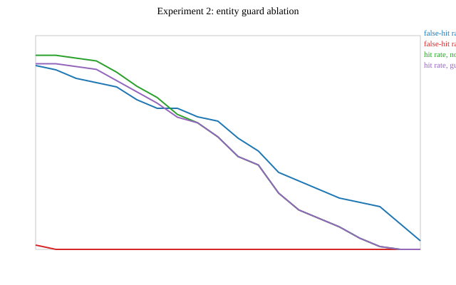

# Experiment 2: entity guard ablation

Experiment 2 of the M6 benchmarking milestone (docs/design/requirements.md).
Generated by `EntityGuardAblationExperimentTest`, re-running experiment
1's sweep with `EntityNumericGuard` on and off, against the same full
corpus (76 near-duplicate pairs, 50 adversarial pairs).

Raw data: `experiment-2-guard-ablation.csv`.

## Guard effect at threshold 0.94

- False-hit rate reduction: 28.0% (28.0% -> 0.0%)
- Recall cost: 0.0% (14.5% -> 14.5%)

## Adversarial pairs the guard still allows at threshold 0.94

None.

## Guard cost

`EntityNumericGuard.fingerprint` runs once per semantic lookup (the
stored side is persisted at write time). Mean wall-clock time per
call, single thread, after warm-up, on this run's machine:

- Short prompts (402 near-duplicate, adversarial and unrelated prompts): 61.3 us
- Long-context prompts (100 prompts, ~4-5k tokens each): 13.71 ms

Embedding the same prompt with all-MiniLM-L6-v2 is the dominant
per-lookup cost (see experiment 3).

The guard only ever *rejects* candidate hits (it adds no new
similarity-based hits), so at every threshold `hit_rate_guarded <=
hit_rate_no_guard` and `false_hit_rate_guarded <=
false_hit_rate_no_guard` - verified directly by this test's own
assertions on every swept threshold, not just the reference point
above.
